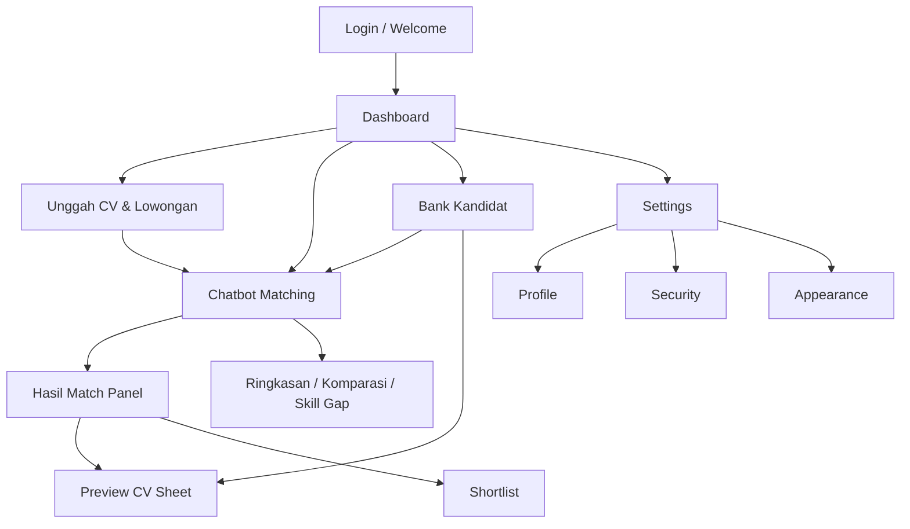
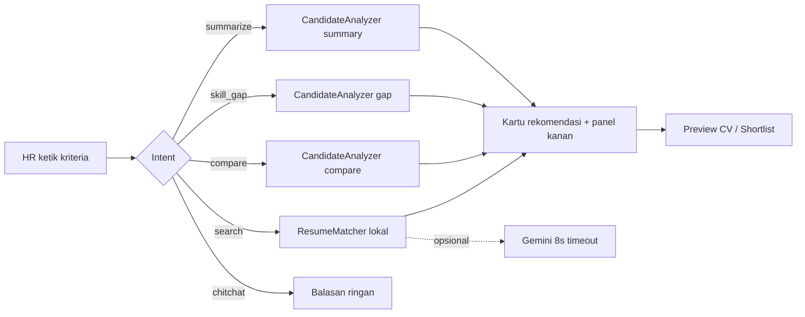

# Jobmatch — Product Flow & Screenshots

Folder ini berisi **flow aplikasi** + **screenshot tiap halaman & fungsi**.

**PDF lengkap (flowchart + fitur + screenshot):** [saas-hr-flow-detail.pdf](./saas-hr-flow-detail.pdf) (~18 halaman)  
Source: [saas-hr-flow-detail.html](./saas-hr-flow-detail.html)

Repo: https://github.com/anpixelstudio/saas-hr

Demo login: `hr@jobmatch.test` / `password`

---

## 1. User journey (HR)

---

## 2. Flow fitur chatbot

---

## 3. Peta halaman → screenshot

| # | Halaman / fungsi | Path | File |
|---|------------------|------|------|
| 1 | Guest home → login | `/` | `01-auth/01-welcome-login.png` |
| 2 | Login | `/login` | `01-auth/02-login.png` |
| 3 | Register | `/register` | `01-auth/03-register.png` |
| 4 | Dashboard | `/dashboard` | `02-dashboard/01-dashboard.png` |
| 5 | Chat — thread + panel match | `/chat` | `03-chat/01-chat-main.png` |
| 6 | Chat — lowongan select terbuka | `/chat` | `03-chat/02-chat-job-select.png` |
| 7 | Chat — preview CV sheet | `/chat` | `03-chat/03-cv-preview.png` |
| 8 | Kandidat — list | `/candidates` | `04-candidates/01-list.png` |
| 9 | Kandidat — filter IT | `/candidates?category=INFORMATION-TECHNOLOGY` | `04-candidates/02-filter-category.png` |
| 10 | Kandidat — dropdown kategori | `/candidates` | `04-candidates/03-dropdown-category.png` |
| 11 | Kandidat — preview CV | sheet | `04-candidates/04-cv-preview.png` |
| 12 | Unggah CV & lowongan | `/uploads` | `05-uploads/01-uploads.png` |
| 13 | Unggah — select lowongan | `/uploads` | `05-uploads/02-job-select.png` |
| 14 | Settings — Appearance | `/settings/appearance` | `06-settings/01-appearance.png` |
| 15 | Settings — Profile | `/settings/profile` | `06-settings/02-profile.png` |
| 16 | Confirm password (gate security) | `/user/confirm-password` | `06-settings/03-confirm-password.png` |
| 17 | Settings — Security | `/settings/security` | `06-settings/04-security.png` |
| 18 | User menu dropdown | global | `07-flows/01-user-menu.png` |

---

## 4. Ringkas fungsi per modul

### Dashboard
Ringkasan korpus CV (Kaggle + upload), antrean parse, lowongan aktif, query chat 7 hari, shortcut ke Chat / Unggah / Kandidat.

### Chatbot
- Matching kriteria (skill, kategori, pengalaman)
- Ringkasan kualifikasi kandidat
- Komparasi 2 kandidat
- Skill gap vs kriteria
- Panel hasil match + Preview CV + Shortlist
- Lock lowongan di composer (FieldSelect)

### Kandidat
Bank CV, cari teks, filter kategori/sumber, pagination, klik baris → preview sheet.

### Unggah
Buat/simpan lowongan, unggah berkas CV, tautkan ke lowongan opsional, indeks untuk matching.

### Settings
Profil, keamanan (password / 2FA / passkey), tema Light/Dark/System.
