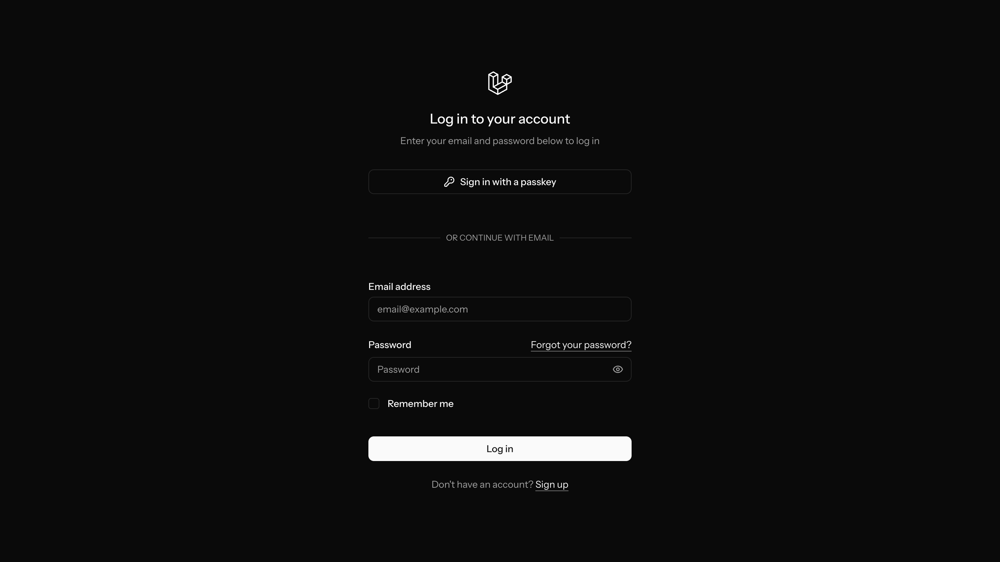
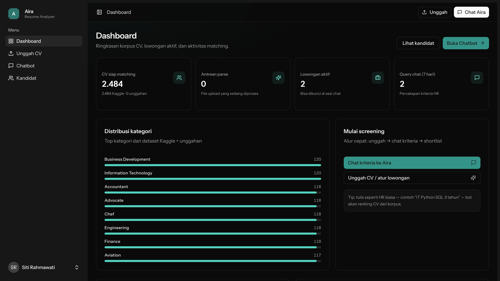
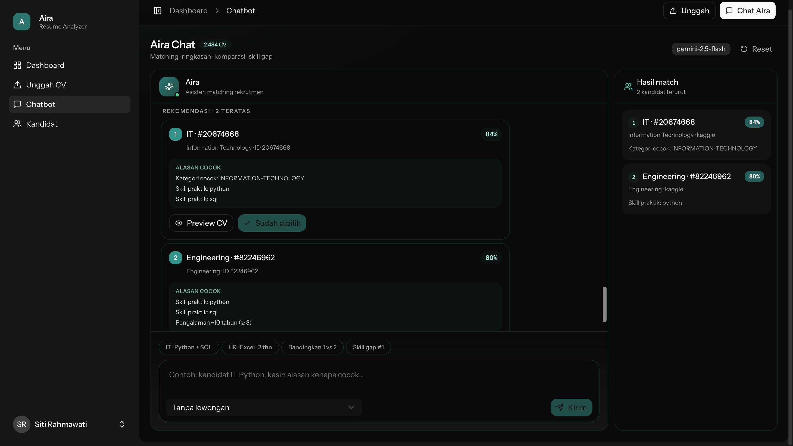
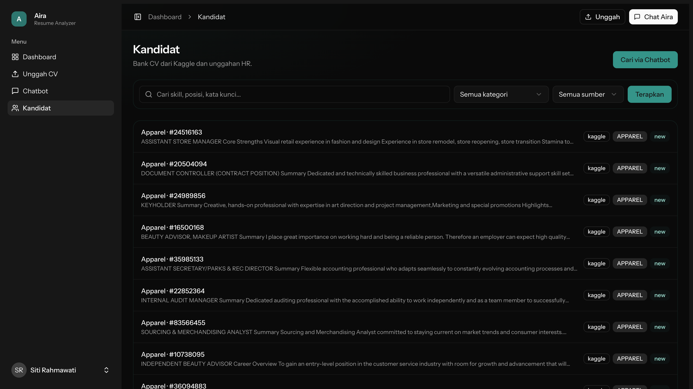
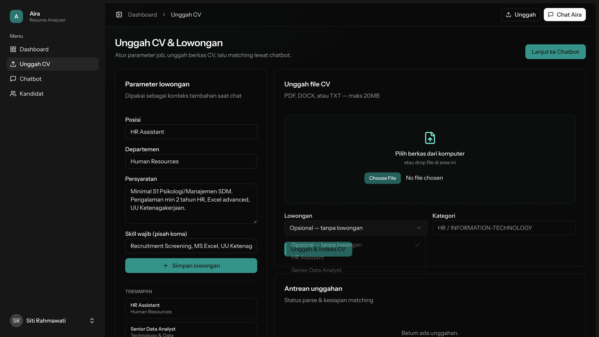

# Screenshots — Jobmatch

Dokumentasi visual halaman + fungsi aplikasi.

- **PDF flow detail:** [saas-hr-flow-detail.pdf](./saas-hr-flow-detail.pdf)
- Ringkas Mermaid: [FLOW.md](./FLOW.md)

## Struktur

```
screenshots/
├── FLOW.md                 # Flow diagram + indeks
├── README.md               # File ini
├── 01-auth/                # Login & register
├── 02-dashboard/           # Dashboard HR
├── 03-chat/                # Chatbot matching + preview CV
├── 04-candidates/          # Bank kandidat + filter + preview
├── 05-uploads/             # Unggah CV & lowongan
├── 06-settings/            # Profile / security / appearance
└── 07-flows/               # User menu & cross-cutting UI
```

## Quick preview

| Modul     | Contoh                                        |
| --------- | --------------------------------------------- |
| Auth      |               |
| Dashboard |  |
| Chat      |            |
| Kandidat  |     |
| Unggah    |        |

> Gambar di tabel di atas merujuk file relatif; buka folder masing-masing untuk full-size PNG.
